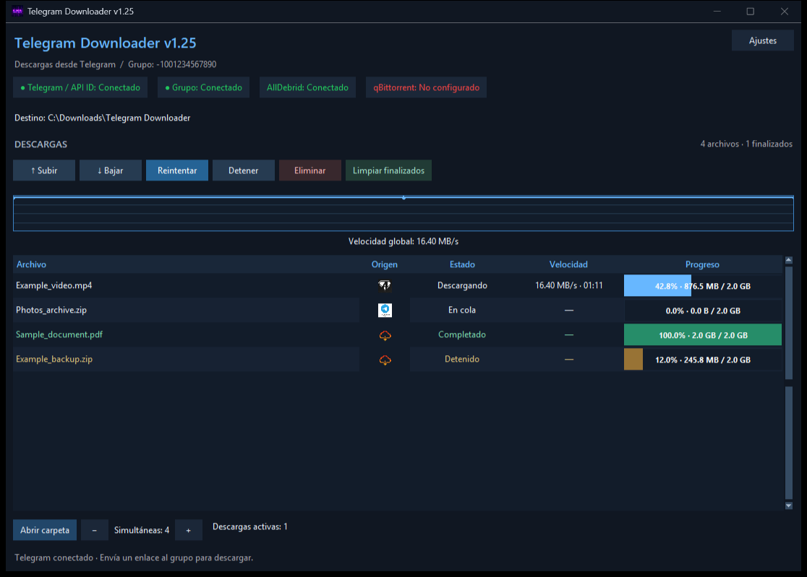
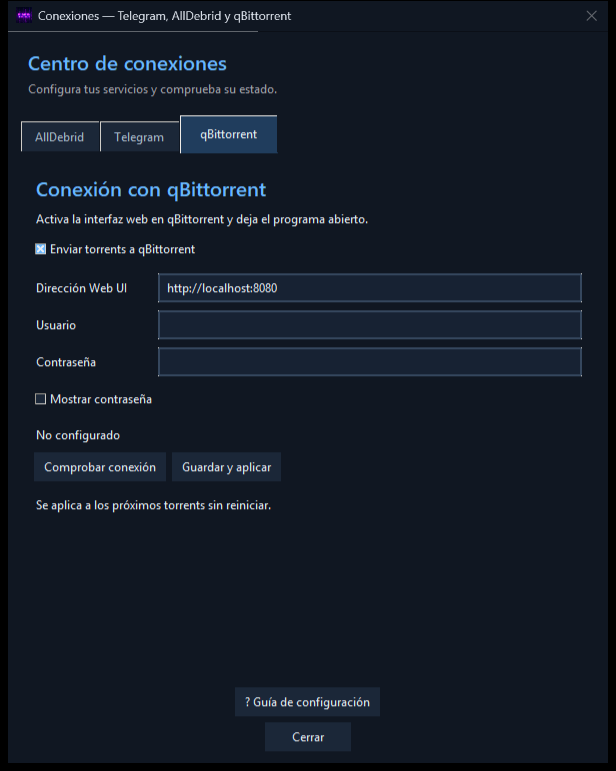
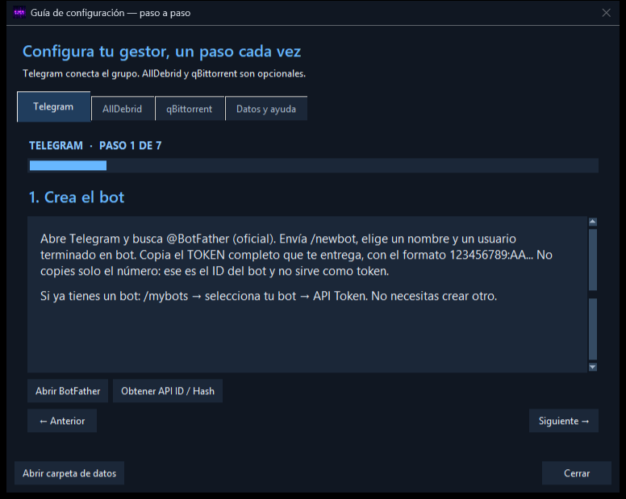

# Telegram Downloader

**Convierte un grupo de Telegram en la cola de descargas de tu PC Windows.**

[English](README.md) · [Español](README.es.md) · [Descargar](https://github.com/IMC93Labs/Telegram-Downloader/releases/latest)

 

Envía un enlace o reenvía un archivo al grupo configurado. La aplicación lo añade a la cola y lo descarga en el PC. Puede utilizar **AllDebrid** para enlaces premium compatibles y enviar **magnets y torrents a qBittorrent**.

La interfaz está en español. La documentación y las instrucciones están disponibles en español e inglés.



## Funciones

| Función | Qué permite |
|---|---|
| Entrada desde Telegram | Conectar una cuenta personal o un bot a un grupo/canal. |
| Cola de descargas | Cambiar el orden, detener, reintentar, eliminar y limpiar finalizados. |
| Descargas simultáneas | Ajustar el límite desde la ventana principal. |
| Descarga directa | Recibir archivos de Telegram y enlaces de descarga HTTP/HTTPS. |
| AllDebrid | Desbloquear enlaces compatibles con clave y cuenta premium/prueba válidas. |
| qBittorrent | Enviar magnets y archivos `.torrent` mediante su interfaz web. |
| Información en directo | Ver velocidad, progreso, estado, tamaños y gráfica. |
| Ventana adaptable | Columnas ajustadas al ancho y scroll solo en la lista; detalles completos al pasar el ratón. |
| Ajustes de conexiones | Cambiar credenciales, comprobar servicios y obtener el ID desde un enlace de mensaje compatible. |
| Ayuda integrada | Seguir pasos visuales con accesos oficiales y solución de problemas. |
| Escritorio | Minimización opcional en bandeja e inicio con Windows. |

## Descargar e instalar

1. Abre la [última versión](https://github.com/IMC93Labs/Telegram-Downloader/releases/latest).
2. Descarga **`TelegramDownloader_Setup_v1.25.exe`** para instalar o **`TelegramDownloader_v1.25.exe`** para ejecutar directamente.
3. Abre **Ajustes → Conexiones**.
4. Sigue **? Guía de configuración** o la [guía detallada en español](docs/SETUP.es.md).

El PC y la aplicación deben permanecer encendidos para recibir mensajes y descargar. qBittorrent también debe estar abierto al enviar torrents. El EXE independiente guarda los ajustes en el perfil de Windows: no es una instalación portable contenida en una sola carpeta.

## Configurar los servicios

### Telegram — necesario

Para utilizar un bot, créalo con **@BotFather**, copia su **token completo**, añádelo al grupo y hazlo administrador para que reciba mensajes normales. Obtén **API ID y API Hash** desde [my.telegram.org/apps](https://my.telegram.org/apps). Esta aplicación usa Pyrogram/MTProto: ambos datos también son necesarios con un bot.

Introduce API ID, API Hash, token y el **ID del grupo**, y deja el teléfono vacío. Para usar tu cuenta personal, deja el token vacío e introduce tu teléfono con prefijo internacional; Telegram puede pedir código de acceso y contraseña de verificación en dos pasos.

**Telegram/API ID y el acceso al grupo tienen indicadores independientes:** verde conectado; rojo sin conexión, sin configurar o con error. Conectar Telegram no garantiza que esa cuenta o bot tenga acceso al grupo.

### AllDebrid — opcional

Crea o recupera la clave en [las claves API de AllDebrid](https://alldebrid.com/apikeys/), pégala en su pestaña y pulsa **Comprobar clave → Guardar y aplicar**. Si premium ha caducado, hay que renovarlo en AllDebrid; cambiar la clave no renueva la suscripción.

### qBittorrent — opcional

Activa la **interfaz web** en qBittorrent, configura usuario/contraseña y comprueba el acceso desde el navegador. Introduce esos mismos datos en su pestaña dentro de Telegram Downloader, activa el envío de torrents, comprueba y guarda. La dirección local habitual es `http://localhost:8080`.

**Enviado a qBittorrent** confirma la entrega del torrent; su progreso real se consulta en qBittorrent.





## Privacidad al compartir

- Credenciales, sesiones de Telegram, ajustes e historial se guardan en **`%LOCALAPPDATA%\TelegramDownloader`**. Los archivos descargados se guardan en el destino elegido.
- Las credenciales guardadas **no están cifradas**. Protege tu cuenta de Windows y no compartas la carpeta de datos ni las sesiones.
- Se ha inspeccionado el EXE publicado: no se han encontrado archivos privados de configuración, sesiones, credenciales conocidas del desarrollador ni rutas de su perfil local. [Revisión de privacidad](docs/PRIVACY.es.md).
- Las capturas contienen descargas simuladas y datos de demostración.
- Comparte los binarios publicados, no una carpeta configurada ni un proyecto que contenga `.env` o `.session` privados.
- La aplicación se comunica con Telegram, AllDebrid y qBittorrent según las funciones utilizadas.

## Código y compilación

Se utiliza **Python 3.11** en Windows:

```powershell
python -m venv .venv
.\.venv\Scripts\Activate.ps1
python -m pip install -r src/requirements.txt
python src/auto.py
```

La ejecución desde el código también utiliza la carpeta local de datos. Para aislar desarrollo y pruebas, configura `TELEGRAM_DOWNLOADER_DATA_DIR` y `DOWNLOAD_PATH` con carpetas separadas.

Pruebas y compilación:

```powershell
cd src
python -m unittest test_application -q
python -m PyInstaller --noconfirm TelegramDownloader_v1.25.spec
```

Para crear el instalador, instala [Inno Setup](https://jrsoftware.org/isinfo.php) y compila `src/TelegramDownloader_v1.25.iss`. Los EXE se publican como adjuntos de Releases, separados del código.

## Límites y soporte

La compatibilidad de AllDebrid depende del servidor y la cuenta. Una página web normal no siempre es un enlace directo de descarga. La reanudación depende del servidor. Los permisos y las restricciones de Telegram afectan a los mensajes y archivos recibidos.

La versión ha pasado **27 pruebas automáticas**, además de comprobaciones de arranque y privacidad del EXE. No equivalen a probar todos los servidores o cuentas.

Utiliza [Issues](https://github.com/IMC93Labs/Telegram-Downloader/issues) para errores y sugerencias: versión, pasos para reproducir y registros sin información sensible. **No publiques contraseñas, tokens, API Hash ni sesiones.**

[Historial de cambios](CHANGELOG.md) · [Configuración detallada](docs/SETUP.es.md) · [English](README.md)
